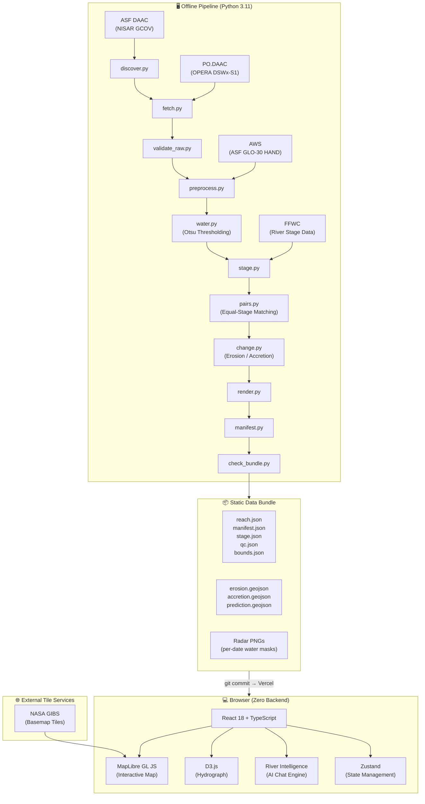
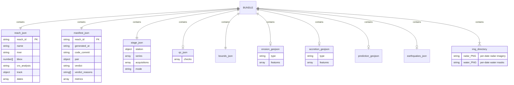

# SAME RIVER TWICE 🛰️ — Satellite-Verified River Erosion Intelligence

<div align="center">


[](https://nasa-space-app-challenge.vercel.app)
[](https://www.spaceappschallenge.org/)
[](LICENSE)

**Measuring what the monsoon takes — not where it floods, but what it permanently erodes.**

[Explore Live Demo](https://nasa-space-app-challenge.vercel.app) · [View Methods](https://nasa-space-app-challenge.vercel.app/methods) · [Report Bug](https://github.com/sakibul-shovon/nasa-space-app-challenge/issues)

</div>

---

## 🚀 Overview

**SAME RIVER TWICE** uses **NASA-ISRO's NISAR L-band radar** from the 2026 monsoon to answer a question that optical satellites cannot: *How much land did the Jamuna River permanently take — not flood temporarily, but erode forever?*

The key scientific insight is **stage-matching**: by comparing the river at the *same water level* before and after the monsoon peak, we separate permanent bank erosion from temporary seasonal flooding. Every result is cross-checked against NASA's independent OPERA DSWx-S1 water product, subjected to threshold sensitivity analysis, and linked to exact source granules.

### Key Highlights
- 🛰️ **NISAR L-Band Radar**: Works through monsoon clouds, day and night — exactly when erosion happens.
- 🔬 **Stage-Matched Change Detection**: Compares the river at identical water levels to isolate permanent land loss from temporary flood.
- 📊 **5-Stage Evidence Trail**: Detect → Investigate → Challenge → Explain → Field — every claim is verifiable.
- 🗺️ **Interactive Map with Animated Overlays**: Erosion, accretion, earthquake epicenters, and AI-powered erosion forecasting.
- 🤖 **River Intelligence AI Chat**: Context-aware assistant that answers questions using live data from the bundle.
- 📡 **Full Provenance Chain**: Every number traces to a specific granule ID, gauge reading, and code commit.

---

## 🏛️ System Architecture

SAME RIVER TWICE is a **two-phase system**: an offline Python pipeline that processes raw satellite data into a verified data bundle, and a static React web app that renders the results with zero backend dependencies.



---

## 📦 Data Bundle Schema

Every reach produces a self-contained, versioned data bundle at `web/public/data/v1/<reach_id>/`. The bundle is the contract between the pipeline and the web app.

<details>
<summary>📐 <b>Click to expand Bundle File Schema</b></summary>



</details>

---

## 📑 Feature Modules

| Module | Route | Key Capabilities |
|---|---|---|
| **Landing** | `/` | Hero section with SAR science education, pipeline visualization, data source cards, and evidence trail preview. |
| **Main App** | `/app` | Full investigation interface: interactive map, hydrograph, story panel, evidence panel, QC panel, and AI chat. |
| **Methods** | `/methods` | Complete scientific methodology with reproducibility instructions and data source documentation. |
| **Cases** | `/cases` | Case studies demonstrating erosion detection on the Jamuna, with before/after comparisons. |
| **About** | `/about` | Team information, project motivation, and NASA Space Apps Challenge context. |
| **Auth** | `/auth` | Simple login gate for the investigation interface. |

### Core Investigation Features

| Feature | Component | What It Does |
|---|---|---|
| **Radar Map** | `MapStage.tsx` | MapLibre GL JS rendering of per-date NISAR radar imagery with erosion/accretion GeoJSON overlays. |
| **Hydrograph** | `Hydrograph.tsx` | D3-powered river stage timeline showing gauge heights, NISAR acquisition dates, and danger levels. |
| **Match Water** | `MatchWaterButton.tsx` | One-click stage-matching: locks two dates at equal water level for erosion comparison. |
| **Swipe Compare** | `CompareSwipe.tsx` | Before/after swipe comparison of radar imagery at matched water levels. |
| **Evidence Trail** | `EvidenceTabs.tsx` | 5-stage agentic workflow: Detect → Investigate → Challenge → Explain → Field. |
| **Earthquake Overlay** | `bundleLayers.ts` | Pulsing animated epicenters from earthquake data with click-to-inspect popups. |
| **Erosion Forecast** | `bundleLayers.ts` | AI-predicted erosion/accretion/ambiguity zones with animated fill layers and legend. |
| **River Intelligence** | `ChatWidget.tsx` | Side-panel AI chat that answers questions using data from the loaded bundle — no backend needed. |
| **Cinematic Mode** | `CinematicDescription.tsx` | Auto-generated narrative descriptions of what the user is looking at on the map. |
| **Inspect Mode** | `Inspectable.tsx` | Click any data element to see its raw source, provenance, and method reference. |

---

## 💻 Tech Stack

### Frontend (Web App)
| Technology | Purpose |
|---|---|
| **React 18** | Component-based UI framework |
| **TypeScript** | Type-safe development across the entire frontend |
| **Vite 5** | Build tool with instant hot reload |
| **MapLibre GL JS 5** | GPU-accelerated interactive map rendering |
| **D3.js** (d3-scale, d3-shape, d3-array) | Hydrograph visualization and data-driven SVG |
| **Zustand 4** | Lightweight, hook-based global state management |
| **Vanilla CSS** | Custom design system with CSS variables — no framework overhead |
| **IBM Plex Sans / Mono + Inter** | Typography via Google Fonts |

### Backend Pipeline (Python)
| Technology | Purpose |
|---|---|
| **Python 3.11** | Pipeline runtime |
| **earthaccess** | NASA Earthdata authentication and S3 credential management |
| **asf_search** | Granule discovery from Alaska Satellite Facility |
| **h5py / xarray / h5netcdf** | Reading NISAR GCOV HDF5 products |
| **rasterio / rioxarray** | GeoTIFF I/O, reprojection, and AOI clipping |
| **numpy / scipy** | Numerical processing and filtering |
| **scikit-image** | Otsu thresholding for water classification |
| **geopandas / shapely** | Vector operations on erosion/accretion polygons |
| **pydantic** | Schema validation for pipeline outputs |
| **jsonschema** | Bundle integrity verification |

### Infrastructure
| Technology | Purpose |
|---|---|
| **Vercel** | Static hosting with CDN (zero backend) |
| **NASA GIBS** | Basemap tile service (WMTS) for satellite context imagery |
| **GitHub** | Source control and CI |

---

## 🔬 Scientific Method

### The Core Insight: Stage-Matching

Traditional flood maps show where water is *on a given day*. But during monsoon, everything is flooded — that doesn't mean the land is gone. Our method:

1. **Acquire** NISAR L-band radar passes throughout the monsoon (June–November 2026).
2. **Classify** each pass into water/land using Otsu thresholding on calibrated γ⁰ backscatter.
3. **Match stages**: find two dates where the river gauge reads the same height (or later is lower).
4. **Subtract**: a pixel that was land at t₀ and is water at t₁ *at the same river level* = **permanent erosion**, not flood.
5. **Validate**: cross-check against NASA OPERA DSWx-S1 (independent Sentinel-1 water product), threshold sensitivity, and RFI screening.

### Change Classification
| Class | Color | Definition |
|---|---|---|
| **Erosion** | 🔴 `#E4572E` | Land at t₀ → water at t₁, at equal or lower stage. Confirmed persistent. |
| **Accretion** | 🟡 `#D9B26A` | Water at t₀ → land at t₁. New char/sandbar formation. |
| **Ambiguous** | ⚫ `#8A9299` | Changed but failed persistence or DSWx cross-check. |

---

## 🛰️ Data Sources

| Source | Dataset | Role | DOI / Reference |
|---|---|---|---|
| **NASA-ISRO** | NISAR L2 GCOV Provisional V1 | Primary measurement — calibrated γ⁰ backscatter | `10.5067/NIL2GCOV-P1` |
| **NASA** | OPERA L3 DSWx-S1 V1 | Independent validation — Sentinel-1 water extent | `10.5067/OPDSWS1-L3V1` |
| **ASF** | GLO-30 HAND | Terrain mask — excludes water on high ground | CC0 Open Data |
| **NASA** | GPM IMERG Daily | Rainfall context — precipitation anomaly check | `10.5067/GPM/IMERGDL/DAY/07` |
| **JRC** | Global Surface Water Occurrence | Permanent water reference mask | [JRC GSW](https://global-surface-water.appspot.com/) |
| **BWDB/FFWC** | River Stage Bulletins | Gauge heights for stage-matching | [FFWC API](https://api3.ffwc.gov.bd) |
| **NASA** | GIBS WMTS | Basemap context tiles for the web app | [GIBS](https://earthdata.nasa.gov/gibs) |

---

## 🗄️ Pipeline Steps

The pipeline transforms raw satellite data into a verified data bundle. Each step is independently runnable via `make`.

```bash
make discover   REACH=jamuna-chilmari   # Find NISAR GCOV granules for the AOI
make fetch      REACH=jamuna-chilmari   # Download & AOI-clip to GeoTIFF
make validate-raw REACH=jamuna-chilmari # Reject broken/partial inputs
make preprocess REACH=jamuna-chilmari   # dB conversion & spatial filtering
make water      REACH=jamuna-chilmari   # Otsu thresholding → water masks
make stage      REACH=jamuna-chilmari   # Match gauge heights to acquisitions
make pairs      REACH=jamuna-chilmari   # Select equal-stage date pairs
make change     REACH=jamuna-chilmari   # Erosion / accretion classification
make render     REACH=jamuna-chilmari   # Generate map-ready PNGs
make manifest   REACH=jamuna-chilmari   # Build provenance manifest
make check-bundle REACH=jamuna-chilmari # Verify bundle integrity
```

---

## 🛡️ Quality Control & Verification

Every result passes through a multi-layer verification system visible in the **Evidence Panel**:

| Check | What It Verifies | Status |
|---|---|---|
| `threshold_sensitivity` | Result is stable across ±1 dB threshold shifts | PASS / WARN / FAIL |
| `dswx_agreement` | Erosion zones match OPERA DSWx-S1 water extent | PASS / WARN / NOT_EVALUATED |
| `rfi_screening` | No radio frequency interference corrupted the radar | PASS / WARN |
| `temporal_persistence` | Changes persist across multiple acquisitions | PASS / WARN |
| `stage_match_quality` | Gauge heights within ±0.15 m between compared dates | PASS / FAIL |
| `null_test` | No erosion detected in known-stable reference areas | PASS / FAIL |
| `order_of_magnitude` | Erosion area is plausible vs. CEGIS historical rates | PASS / WARN |

**Verdict System**: Each reach receives a verdict of **SUPPORTED**, **LIMITED**, or **INCONCLUSIVE** based on how many QC checks pass.

---

## 🧠 Explainable AI (XAI) Framework

To build trust in our automated detection, the system doesn't just output a final verdict—it explains *why* using an **Explainable AI (XAI) Attribution** model. Users can inspect the exact weight of each feature that contributed to the final decision. 

The primary features analyzed are:
1. **SAR Backscatter Intensity:** The primary difference in radar return signal between the two dates.
2. **Sentinel-1 Optical Match:** Cross-validation using independent optical or DSWx-S1 data.
3. **Hydrological Stage Context:** Whether the river gauge heights match appropriately.
4. **Geomorphic Prior Models:** Checking if the detected erosion exceeds plausible historical bounds (e.g., CEGIS reference figures).

In the web app's `EXPLAIN` panel, these feature attributions are visually broken down into percentages (e.g., 78.2% SAR Backscatter, 14.5% Optical Match) alongside the final system verdict, making the AI's "black box" fully transparent to researchers and policymakers.

---

## 🎨 Design System

The visual language is purpose-built for scientific data communication — dark, precise, and information-dense.

| Token | Value | Purpose |
|---|---|---|
| `--bg` | `#0E1113` | App background — maximum contrast for radar imagery |
| `--water` | `#39C4D9` | Primary accent — represents water/technology |
| `--erosion` | `#E4572E` | Danger — land lost to the river |
| `--accretion` | `#D9B26A` | New land formed |
| `--text` | `#E6E8EA` | Primary text on dark backgrounds |
| `--font-text` | IBM Plex Sans | Body text — engineered for data-heavy interfaces |
| `--font-num` | IBM Plex Mono | Numbers and measurements — tabular alignment |
| `--font-display` | Inter | Headlines and navigation |

---

## 🛠️ Quick Start (Local Setup)

### 1. Prerequisites
- Node.js `18.x` or higher
- Python `3.11` (for pipeline only)
- A free [NASA Earthdata](https://urs.earthdata.nasa.gov/) account (for pipeline only)

### 2. Clone & Install
```bash
git clone https://github.com/sakibul-shovon/nasa-space-app-challenge.git
cd nasa-space-app-challenge/web
npm install
```

### 3. Launch Development Server
```bash
npm run dev
```
Open [http://localhost:5173](http://localhost:5173) in your browser. Navigate to `/app` to see the investigation interface.

### 4. Run the Pipeline (Optional)
```bash
# Set up the Python environment
conda env create -f environment.yml
conda activate srt-pipeline

# Configure Earthdata credentials
echo "machine urs.earthdata.nasa.gov login <USER> password <PASS>" > ~/.netrc

# Run the full pipeline for a reach
make discover REACH=jamuna-chilmari
make fetch REACH=jamuna-chilmari
# ... (see Pipeline Steps above)
```

---

## 🚢 Deploying to Vercel

```bash
# Install Vercel CLI
npm i -g vercel

# Deploy from project root
vercel --prod
```

The `vercel.json` configuration handles the build command (`cd web && npm install && npm run build`), output directory (`web/dist`), and SPA routing.

---

## 📄 License

Distributed under the MIT License. See `LICENSE` for more information.

---

<div align="center">

Built with 🛰️ for the **NASA Space Apps Challenge 2026** — *Dancing with the SARs*

*"We compared the Jamuna at the same water level before and after the 2026 monsoon using NASA-ISRO's NISAR radar — so what changed isn't flood, it's land the river took."*

</div>
